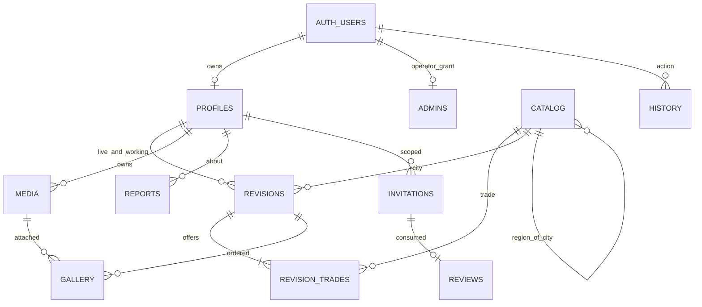

# Database

`supabase/migrations/202611190001_directory.sql` defines the directory, RPC grants and bucket. `202611190002_media_library.sql` adds removal of unreferenced assets. They apply in timestamp order. Generate API types using `npm run db:types`; JSON projection types live in `src/lib/model.ts`. Use a new forward migration for changes after deployment.

`directory` is a non-exposed schema. `profiles.id` is public; `owner_id` is private, unique and distinct from the public ID. Composite foreign keys prevent pointing at another profile’s revision. A city has a region parent; a revision stores a city, not a redundant region. Catalog writes validate the parent kind. Historical neighborhood relationships are retained privately but are no longer used for discovery or exposed in projections.

`fee IS NULL` = not specified, `0` = free; a positive integer is a fixed visit fee in MAD. Phone and consent belong to the revision. `available_at`, staff-checked phone and verification time belong to the profile, separate from editable data. `gallery` enforces unique rank 1–8 and no duplicate asset per revision. `media.id` determines both Storage object names. `limits` holds hourly counters under keyed hashes. Reports, job evidence and staff history never enter a public projection.

### Transitions

| Operation                                | Working state | Public view                                                         |
| ---------------------------------------- | ------------- | ------------------------------------------------------------------- |
| First save / edit                        | `draft`       | Nothing for a new listing; previous approved version otherwise      |
| Submit with consent                      | `pending`     | Same public snapshot                                                |
| Request changes with feedback            | `draft`       | Same public snapshot                                                |
| Approve exact reviewed revision          | `published`   | Atomically switch `live` to `working`; discard superseded revisions |
| Save without consent                     | `draft`       | Clear `live` immediately                                            |
| Suspend                                  | `suspended`   | Clear `live`, availability and verification; deny editing           |
| Return suspended listing for corrections | `draft`       | Hidden until resubmitted and approved                               |

City/revision and trade/revision indexes support directory filters. A partial live-profile index excludes suspended records. Primary keys cover owner lookup, hashed invitation lookup and ordered revision membership. The approved-review index supports public review counts, averages and date ordering. Search order ends in unique public ID.

### Fixtures and verification

The [national catalog](catalog.md) is installed by migrations, independently of fixtures. `scripts/demo.sql` references the email identities provisioned locally and assigns fixed public IDs. The guarded Node seed registers the drawing in Storage and the gallery. Relative availability dates exercise expiry regardless of reset date. `tests/database.test.ts` applies the actual SQL to an isolated PostgreSQL engine, changes session roles and exercises publication, access, review consumption and suspension. The browser suite checks the same flows through PostgREST/Auth/Storage.
